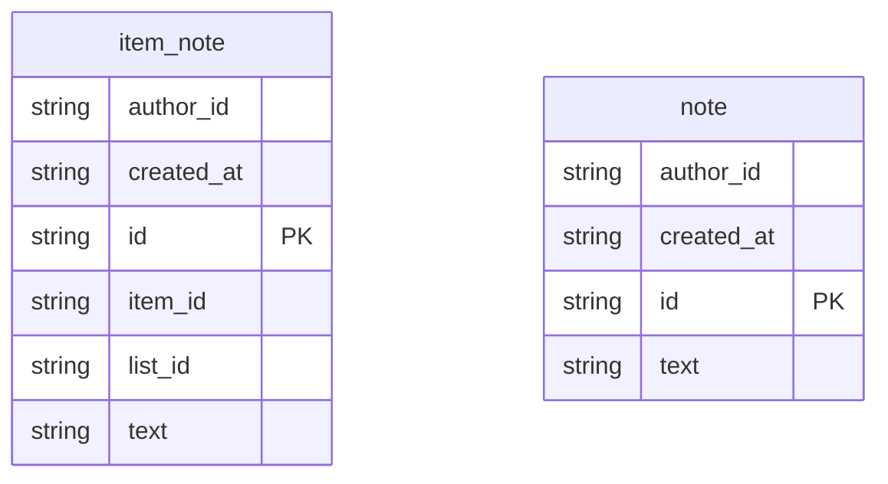

# Notes — concept

> A plugin of the Todo demo: a second vertical in the same tenant that owns no people. The
> smallest thing that proves one app can take its people from another.

## What it is

A shared notepad for a Todo workspace. A member writes a note; every member who may use the
workspace's plugins reads them all. That is the whole product, on purpose: the subject here is
who gets in, not what they do once inside.

## Who owns what

| | Todo (the host app) | Notes (the plugin) |
|---|---|---|
| People, and who may use plugins | owns | asks |
| Sign-in | the tenant's issuer | the same issuer |
| Invitations, owner seat | its own | none |
| Data | lists and items | notes, in its own scope |
| Code and deploys | its own | its own |

Notes runs as its own vertical, with its own scope and its own database. It cannot read a
Todo table, and Todo cannot read a note.

## How a person gets in

Notes declares that it calls Todo (`substrat.calls`), and Todo allowlists it as a peer for one
operation: `todo/resolve-person`, the person contract (`identity.person@1`).

1. Somebody signs in to Notes at the shared issuer.
2. Notes has not seen the login, so it asks Todo who it is.
3. Todo answers with the member's id and the roles they hold for plugins, or with nobody.
4. Notes lets the person in as that id, seats the roles it maps them to, and keeps the answer
   for five minutes.

After five minutes the next request asks again. So when a Todo admin takes a member's plugin
access away, that member loses Notes within five minutes, and nothing has to be pushed.

## Design decisions

- **The copy is lazy.** Nobody is synchronised ahead of time; a person is copied when they
  first sign in. Only people who use Notes are ever known to it.
- **The member's id in Todo is their principal in Notes.** One person, one id, in both.
- **It fails closed.** If the answer is older than five minutes and Todo cannot be reached,
  Notes admits nobody.
- **Roles.** Todo answers `member` for someone with plugin access; Notes maps that to its own
  `writer` (read and write notes). A member without access is known and holds nothing.
- **No name or address is copied.** The answer carries an id, a status and role keys. A note
  shows its author's id; showing a name is a later, separate read from Todo.

## Roles

<!-- substrat:roles -->

| Role | What they can do |
| --- | --- |
| `writer` | `note:read` — Read the notes in this workspace `note:write` — Write a note |

<!-- /substrat:roles -->

## Entities

<!-- substrat:entities -->

<!-- /substrat:entities -->

## Processes

<!-- substrat:processes -->

_No lifecycle is declared: nothing here moves through stages._

<!-- /substrat:processes -->

## The scenario the test replays

1. Ada, the Todo admin, gives Björn plugin access.
2. Björn signs in to Notes directly, is let in and writes a note.
3. Cleo, a member of another tenant's Todo, is refused.
4. Ada takes Björn's access away. He keeps it until his copy expires, then is refused.
5. With Todo unreachable and his copy expired, nobody is admitted.

## Decisions log

- 2026-11-13: First version. One entity (`note`), two operations, two keys (`note:read`,
  `note:write`) and one role, `writer`, which holds both and is seated only by the door, from what
  Todo answers.
- 2026-11-13: One screen (`app/`): the notes, and a box to write one, with a message for each of
  the door's refusals. No key, role or operation changed.
- 2026-11-13: Notes on Todo's items (`item_note`, `notes/add-item-note`, `notes/list-item-notes`), kept
  apart from the notepad. The two operations have no route of their own: the door's routes ask Todo
  (`todo/vouch-access`) whether the person may see the list or item first. No key or role changed.
