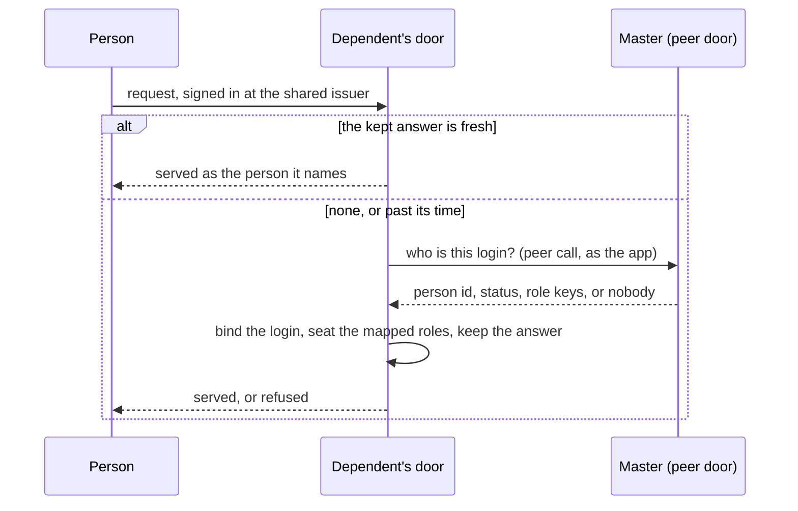

# RFC: a vertical that takes its people from another app

**Status:** proposed; first slice built (pure host, `demos/notes` beside `demos/todo`) ·
**Touches:** `@substrat-run/contracts` (`people.ts`), `@substrat-run/vertical-auth` (`people.ts`),
`@substrat-run/dev-issuer` (`people.ts`), `demos/todo`, `demos/notes`

## 1. The need

A product built on Substrat wants **plugins**: apps that run isolated from it, can be built and
published separately, and are used by the same people. A CRM beside a workspace app, say.

Isolation is already the platform's: a plugin is its own vertical, with its own deployment, scope
and sandbox. What is missing is the people. Today every vertical owns who is in its scope: an owner
claims the seat, members are invited, and the identity directory maps each login to a principal
(`vertical-auth-detach.md` §2.3). Two verticals of one tenant on one issuer share a sign-in and
nothing else, so a team would manage its members once per plugin.

## 2. The shape

One app of the tenant owns the people (the **master**). A plugin (a **dependent**) owns none: no
owner claim, no invitations, no linking. It signs people in at the same issuer as every vertical
does, and asks the master who each login is.

- **The contract** is `identity.person@1` (`packages/contracts/src/people.ts`): one operation the
  master implements, taking the login (issuer, sub, verified address) and answering an id, a status
  (`invited`, `active`, `blocked`) and the master's role keys, or nobody. It carries no name and no
  address.
- **The master allowlists the dependent as a peer** for that operation (#1706). The key it checks is
  declared `holder: 'system'`, so no person's role can carry it (#2430).
- **The dependent's door** is `admitPerson` (`packages/vertical-auth/src/people.ts`). The master's id
  becomes the person's principal in the dependent's scope, the master's roles are mapped onto the
  dependent's own and seated, and the answer is kept for `PEOPLE_TTL_SECONDS` (300).
- **`ctx.check` is unchanged**, and local. The network call is at the door, when an answer is
  missing or past its time, and never per check.

## 3. Decisions taken in this slice

| # | Decision | Why |
|---|---|---|
| 1 | **The copy is lazy.** A person is copied when they first sign in to the dependent; nothing is synchronised ahead. | No first sync, no backlog, and only people who use a plugin are known to it. The master answers per login, so disclosure follows use. |
| 2 | **The answer expires, and that is the revocation bound.** A block or a changed role reaches the dependent within the time an answer is kept. | It needs no delivery guarantee. An event edge can be paused or skipped (`cross-vertical-events.md`), and a lost block is not acceptable. Events can be added later as a faster path, with expiry still the backstop. |
| 3 | **It fails closed.** An answer past its time with a master that does not answer admits nobody. | The other choice keeps a blocked person in for as long as an outage lasts. An outage shorter than the kept time goes unnoticed. |
| 4 | **The master's person id is the principal.** | One person is one id in both apps. Several logins, a changed issuer, and moving a running vertical onto a master all reduce to which login maps to that id. |
| 5 | **Only the authorisation half is copied.** | The rule that only `piiClass: 'none'` crosses stands untouched: no name and no address is kept. What is kept is each login's `sub` beside the principal and status, and the roles seated per principal. A `sub` is the issuer's identifier for a person, and an issuer may use an address as one, so these rows are personal data an erasure has to reach (§5.2). |
| 6 | **Roles are seated per person, answers are kept per login.** | Two logins of one person share one set of roles. |
| 7 | **The reference master matches a login on its verified address.** The contract carries issuer and sub as well. | Module code is handed the verified address (`ctx.verifiedEmail`, K-61) and not the subject. A master that records logins matches on those, and no dependent changes. |

### This is a copy per scope, and the kernel design warns against those

[kernel-design.md](../architecture/kernel-design.md) rejects "an authoritative copy per scope" for a
tenant-wide fact, and K-22 rejected it for membership: nothing keeps N copies in step. It allows a
derived projection whose consumers accept eventual consistency, and says such a projection "cannot
supply a tenant-wide … revocation guarantee".

What is built here is that projection, with the weakness stated as a number. The master stays the
only authority; a dependent's copy is a cache with an expiry, and the guarantee is "within 300
seconds, or refused", never "at once". Whether that is recorded as an amendment, or the people move
to the tenant directory as K-22 moved membership, is the decision this RFC asks for (§5.1).

## 4. What is built, and what is not

Built, on the pure host:

- the contract, the door and its SQL store, with the door's rules under test
  (`packages/vertical-auth/test/people.test.ts`);
- `devPeople` in `@substrat-run/dev-issuer`: the door over a dev server's pieces;
- `demos/todo` as a master: plugin access per member, decided by a new `admin` role, and
  `todo/resolve-person`;
- `demos/notes`, a plugin: its own vertical with no people of its own, one screen, and a suite that
  drives both apps over HTTP as several people (`demos/notes/test/people.test.ts`). Its dev command
  runs Todo's web app too, whose Plugins screen is where an admin decides access.
- Notes on Todo's items, as the first case of a plugin keeping data about the master's records.
  Notes stores them; Todo answers whether a person may see the item (`todo/vouch-access`, another
  system-held key the peer holds), and Notes' door asks before every read and write. Todo shows
  them under each item through its dev proxy.

Not built:

- **The hosted door.** `workerDoor` has no people option, and the identity directory has no tables
  for the copy. `sqlPeopleStore` is written over the directory's own SQL seam so that half is a
  wiring change. Until it lands nothing deployed can depend on another app's people.
- **A declaration `substrat push` reads.** A dependent says so in its host wiring and in
  `substrat.calls`. Nothing refuses a push whose master does not implement the contract, and install
  does not bind the two.
- **The owner seat of a dependent scope.** Provisioning still expects an owner to claim it.
- **Names.** A dependent shows ids. Reading a display name is a separate peer call, or the profile
  half of the contract (§5.2).
- **Access per plugin.** The reference master keeps one flag per member for all plugins, because an
  operation cannot read which peer is calling it.
- **Screens inside the host, deployed.** Todo shows Notes' item notes through its dev proxy, so the
  two are one origin locally. Deployed they are two, and how a plugin's screens appear inside the
  app it belongs to is undecided.
- **A check about another principal.** `todo/vouch-access` answers from the tables that mirror
  Todo's grants, because an operation can only check its own caller. And Notes' operations trust
  their door for the answer, because module code cannot make the call. A kernel check for another
  principal, or a call made as the person (§5.3), would remove both.

## 5. Open questions

### 5.1 A projection with a stated bound, or the tenant directory

The alternative to §3 is that the tenant directory holds the people and a privileged executor seats
them in each scope through `HostAdmin`, as it does for membership. That keeps one copy. It also
makes the people the platform's rather than an app's, which removes the reason a product would be
the master at all. Not decided.

### 5.2 The profile half, and erasure

The copy a dependent keeps today is not empty of personal data: `person_login` holds each login's
`sub`, and the row outlives its expiry, which only stops it being answered from. Nothing deletes it
when the master erases the person. An erasure has to remove a person's login rows and seat row in
every dependent, and the platform has to do it, since the rows are the door's and not module code's.
That is unbuilt.

Names and addresses are deferred, and a plugin that wants them will cache them in its own tables,
which is the copy an erasure cannot reach. The proposed answer is a platform-held profile copy that
module code reads and cannot write, erased by the platform when the master erases. It should be
decided before a second plugin exists, even if it is built later.

### 5.3 Calls on a person's behalf

A peer acts as the app. A plugin reading the master's data for one person needs either the token
exchange #1824 built for MCP extended to peer calls, or the person's id as input, which a
third-party plugin could set to anyone.

### 5.4 Whether this survives merging verticals and modules

If a plugin becomes an isolated module or a scope type (#2993) of the app it belongs to, the door
and the bound stay as they are, and the peer call may become a read inside one app.
