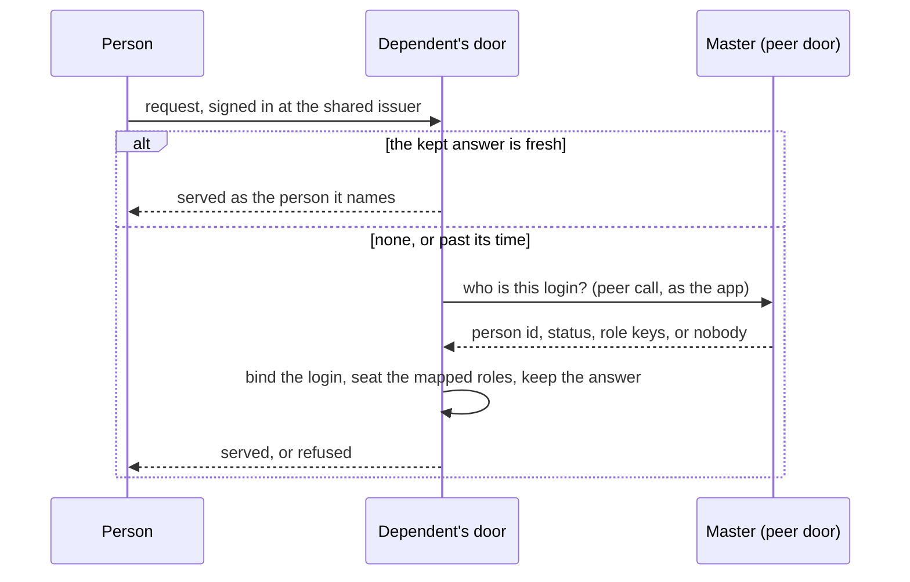

# RFC: a vertical that takes its people from another app

**Status:** building; decided as [K-63](../decisions/K-063-a-tenant-s-people-are-owned-by-one-app-and-its-plugins-keep-the-master-s-answer-for-a-bounded-time.md) on 2026-11-24. The door and the
call made as a person are built on both hosts (#3161), with
`demos/notes` beside `demos/todo` as the reference ·
**Touches:** `@substrat-run/contracts` (`people.ts`, `delegations.ts`), `@substrat-run/vertical-auth`
(`people.ts`, `delegate.ts`), `@substrat-run/kernel` (`delegation-ceiling.ts`),
`@substrat-run/vertical-host` (`worker-door.ts`), `@substrat-run/dev-issuer`, `demos/todo`, `demos/notes`

## 1. The need

A product built on Substrat wants **plugins**: apps that run isolated from it, can be built and
published separately, and are used by the same people. A CRM beside a workspace app, say.

Isolation is already the platform's: a plugin is its own vertical, with its own deployment, scope
and sandbox. What is missing is the people. Today every vertical owns who is in its scope: an owner
claims the seat, members are invited, and the identity directory maps each login to a principal
(`vertical-auth-detach.md` §2.3). Two verticals of one tenant on one issuer share a sign-in and
nothing else, so a team would manage its members once per plugin.

## 2. The shape

One app of the tenant owns the people (the **master**). A plugin (a **dependent**) owns none: no
owner claim, no invitations, no linking. It signs people in at the same issuer as every vertical
does, and asks the master who each login is.

- **The contract** is `identity.person@1` (`packages/contracts/src/people.ts`): one operation the
  master implements, taking the login (issuer, sub, verified address) and answering an id, a status
  (`invited`, `active`, `blocked`) and the master's role keys, or nobody. It carries no name and no
  address.
- **The master allowlists the dependent as a peer** for that operation (#1706). The key it checks is
  declared `holder: 'system'`, so no person's role can carry it (#2430).
- **The dependent's door** is `admitPerson` (`packages/vertical-auth/src/people.ts`). The master's id
  becomes the person's principal in the dependent's scope, the master's roles are mapped onto the
  dependent's own and seated, and the answer is kept for `PEOPLE_TTL_SECONDS` (300).
- **`ctx.check` is unchanged**, and local. The network call is at the door, when an answer is
  missing or past its time, and never per check.

## 3. Decisions taken in this slice

| # | Decision | Why |
|---|---|---|
| 1 | **The copy is lazy.** A person is copied when they first sign in to the dependent; nothing is synchronised ahead. | No first sync, no backlog, and only people who use a plugin are known to it. The master answers per login, so disclosure follows use. |
| 2 | **The answer expires, and that is the revocation bound.** A block or a changed role reaches the dependent within the time an answer is kept. | It needs no delivery guarantee. An event edge can be paused or skipped (`cross-vertical-events.md`), and a lost block is not acceptable. Events can be added later as a faster path, with expiry still the backstop. |
| 3 | **It fails closed.** An answer past its time with a master that does not answer admits nobody. | The other choice keeps a blocked person in for as long as an outage lasts. An outage shorter than the kept time goes unnoticed. |
| 4 | **The master's person id is the principal.** | One person is one id in both apps. Several logins, a changed issuer, and moving a running vertical onto a master all reduce to which login maps to that id. |
| 5 | **Only the authorisation half is copied.** | The rule that only `piiClass: 'none'` crosses stands untouched: no name and no address is kept. What is kept is each login's `sub` beside the principal and status, and the roles seated per principal. A `sub` is the issuer's identifier for a person, and an issuer may use an address as one, so these rows are personal data an erasure has to reach (§5.2). |
| 6 | **Roles are seated per person, answers are kept per login.** | Two logins of one person share one set of roles. |
| 7 | **The reference master matches a login on its verified address.** The contract carries issuer and sub as well. | Module code is handed the verified address (`ctx.verifiedEmail`, K-61) and not the subject. A master that records logins matches on those, and no dependent changes. |

### This is a copy per scope, and the kernel design warns against those

[kernel-design.md](../architecture/kernel-design.md) rejects "an authoritative copy per scope" for a
tenant-wide fact, and K-22 rejected it for membership: nothing keeps N copies in step. It allows a
derived projection whose consumers accept eventual consistency, and says such a projection "cannot
supply a tenant-wide … revocation guarantee".

What is built here is that projection, with the weakness stated as a number. The master stays the
only authority; a dependent's copy is a cache with an expiry, and the guarantee is "within 300
seconds, or refused", never "at once". K-63 records that projection and its bound as the decision,
and the people do not move to the tenant directory as K-22 moved membership (§5.1).

## 4. What is built, and what is not

Built, on the pure host first:

- the contract, the door and its SQL store, with the door's rules under test
  (`packages/vertical-auth/test/people.test.ts`);
- `devPeople` in `@substrat-run/dev-issuer`: the door over a dev server's pieces;
- `demos/todo` as a master: plugin access per member, decided by a new `admin` role, and
  `todo/resolve-person`;
- `demos/notes`, a plugin: its own vertical with no people of its own and no screens of its own,
  and a suite that drives both apps over HTTP as several people (`demos/notes/test/people.test.ts`).
  What it adds is drawn by Todo's app for whoever the plugin lets in: notes under each item, and a
  Notes page. Todo's Plugins screen is where an admin decides who that is.
- Notes on Todo's items, as the first case of a plugin keeping data about the master's records.
  Notes stores them; Todo answers whether a person may see the item (`todo/vouch-access`, another
  system-held key the peer holds), and Notes' door asks before every read and write.

Then, for #3161:

- **The hosted door.** `workerDoor({ people })` (`packages/vertical-host/src/worker-door.ts`) takes a
  dependent's people from its master, keeping the copy in the tenant's identity directory
  (`identityPeopleStore`). A dependent names neither `invites` nor `join`, and has no owner claim.
- **The call a master makes as a person** (§5.3, §6). The master keeps each session's refresh token
  (`refreshTokens` hosted, `devRefreshStore` locally), trades it at the issuer for a token addressed
  to the plugin on the `peer` channel, and makes the peer call with it: `peerAs` hosted, `devDelegate`
  locally. The plugin's door verifies the token, admits the person it names as their own sign-in
  would be, and the call runs as them with the token's keys as a per-call ceiling
  (`packages/kernel/src/delegation-ceiling.ts`, on both adapters). The plugin declares which app may
  act for its people and with which keys (`delegations` in its manifest); `PERMISSIONS.md` renders
  it, and the dashboard delivers it to the team's issuer as the grant the exchange reads.
- **The reference.** Todo writes and reads Notes' notepad as the signed-in person
  (`GET`/`POST /api/plugins/notes/notes`, `demos/notes/test/delegated.test.ts`). Notes delegates its
  notepad keys only: item notes have keys of their own, because their operations rely on the vouch
  of §4's last item, which a call made as a person does not pass.

Not built:
- **A declaration `substrat push` reads.** A dependent says so in its host wiring and in
  `substrat.calls`. Nothing refuses a push whose master does not implement the contract, and install
  does not bind the two.
- **The owner seat of a dependent scope.** Provisioning still expects an owner to claim it.
- **Names.** A dependent shows ids. Reading a display name is a separate peer call, or the profile
  half of the contract (§5.2).
- **Access per plugin.** The reference master keeps one flag per member for all plugins, because an
  operation cannot read which peer is calling it.
- **A plugin's screens, deployed.** Todo draws Notes' features itself and reaches its API through
  the dev proxy, so the two are one origin locally. Deployed they are two origins, and the host
  carries the plugin's screens in its own code. Whether a plugin ships its own UI pieces for the
  host to mount, and how they cross origins, is undecided.
- **A check about another principal.** `todo/vouch-access` answers from the tables that mirror
  Todo's grants, because an operation can only check its own caller. And Notes' item-note
  operations trust their door for the answer, because module code cannot make the call. The call
  made as a person does not remove either: it reaches an operation without passing the door, which
  is why Notes keeps those operations out of what it delegates. A kernel check for another principal
  would remove both.
- **A record of who acted.** A call made as a person writes rows and events as the person. The
  spine does not yet say that Todo made the call (§6).

## 5. Open questions

### 5.1 A projection with a stated bound, or the tenant directory

The alternative to §3 is that the tenant directory holds the people and a privileged executor seats
them in each scope through `HostAdmin`, as it does for membership. That keeps one copy. It also
makes the people the platform's rather than an app's, which removes the reason a product would be
the master at all. **Decided by K-63:** an app is the master, and the people stay out of the
directory. A dependency may set a shorter time than 300 seconds, never a longer one.

### 5.2 The profile half, and erasure

The copy a dependent keeps today is not empty of personal data: `person_login` holds each login's
`sub`, and the row outlives its expiry, which only stops it being answered from. Nothing deletes it
when the master erases the person. An erasure has to remove a person's login rows and seat row in
every dependent, and the platform has to do it, since the rows are the door's and not module code's.
That is unbuilt.

Names and addresses are deferred, and a plugin that wants them will cache them in its own tables,
which is the copy an erasure cannot reach. The proposed answer is a platform-held profile copy that
module code reads and cannot write, erased by the platform when the master erases. **Decided by
K-63**, together with the erasure of a person's login and seat rows in every dependent. Both are
unbuilt.

### 5.3 Calls on a person's behalf

**Answered (#3161): the `peer` channel.** A peer acts as the app. The token exchange #1824 built for
MCP is extended with a second channel: the master presents a live token of the person, issued to it,
names the plugin's client as the audience, and gets one access token with the person as `sub`, the
master in `act`, and the keys the plugin delegated to it as `scope`. A peer call carries it as
`onBehalf`. The person's id as input was not taken, because any caller could set it to anyone.

The other direction is still open: a plugin reading the MASTER's data for one person would need the
master to delegate to it, and no plugin does yet.

### 5.4 Whether this survives merging verticals and modules

If a plugin becomes an isolated module or a scope type (#2993) of the app it belongs to, the door
and the bound stay as they are, and the peer call may become a read inside one app.

## 6. Deployed: a host app that calls its plugin as the person

**Decided (#3161): the token-verified form, not `actingFor`.** The first proposal is kept below,
because what it reverses and what it costs are still the record of why the second was taken.

Locally, Todo's page reaches Notes through the dev proxy, so one origin carries one session. Deployed,
the two are separate origins with separate sessions, and the platform refuses a shared login cookie on
its own hostnames (`cookie-domain.ts`: a parent within the platform's space would reach other tenants'
apps). The chosen answer is that **Todo's worker calls Notes for the person**: the browser talks only
to Todo, and Todo forwards a plugin request to Notes saying which person it acts for.

### What it reverses

The peer door was built to carry no person. Its body is strict "so no field a future caller adds can
make a peer call act as a person" (`vertical-host`, `verticalInvokeBody`), and `getVerticalScope`
states that the caller's signed-in user does not cross. That was right for a peer that is merely
another app of the tenant. It is the thing to change here, and only here.

### What was built: the person's sign-in, proven

The master does not say who it acts for; the issuer does. Todo holds the refresh token of the
person's session at Todo, trades it for a fresh token of that person, and exchanges that for one
addressed to Notes (§5.3). Notes' door verifies the token itself: its issuer, its audience (Notes'
own client), the `peer` channel, and an `act` naming its master. Only then
does it run the person contract's check, as a sign-in would, and the call runs as the person with the
token's `scope` as the ceiling. The router passes the token through and never logs it.

The difference from `actingFor` is what the plugin can rely on. With `actingFor` the master
**asserts** a person, and nothing distinguishes a request P made from one Todo made up. With the
token the master **proves** that P signed in to it: an exchange needs a token issued to Todo for P,
which only P's sign-in at Todo produces. It does not prove that P is still signed in at the issuer.
The refresh token outlives the issuer session it was issued under, and Todo's own session acts for P
in Todo without one anyway. The bound that holds:

- **The master cannot act for someone who never signed in to it**, and a schedule with no session
  behind it cannot act at all.
- **It can act for P while its own session for P lives**, up to that session's lifetime, and while
  the issuer keeps honouring the refresh token.
- **A ban at the issuer stops the next exchange.** The issuer's refresh grant reads no ban, so the
  token exchange refuses a banned person itself, in the words it uses for no person at all.
- **A block at the master stops the plugin within the person contract's TTL.** The plugin's door
  runs the contract's check on every call, as a sign-in would.
- **Signing out of the master stops it**: the sign-out deletes the master's refresh row.
- **Signing out at the issuer alone does not.** The refresh token is not tied to that session, and
  the master's own session still acts for P in the master.
- **The keys are the plugin's to cap, per actor**, and reviewed in its `PERMISSIONS.md`. Under
  `actingFor` Todo would have acted with everything the person holds.
- **No kernel change to the peer door's caller.** A call made as a person is not a peer call with a
  person bolted on: it does not pass the peer door, and `getScope` takes the person with a
  `delegation` beside it.
- **The bound is unchanged.** A token lives 300 s and the kept answer 300 s, so revoked access lands
  within five minutes either way.

What it still does not prove is that P is behind THIS request: Todo holds the refresh token for as
long as its own session for P lives, and could use it while P is away. The spine does not record that Todo
made a call (§4), so today nothing in the plugin's history shows it.

### The proposal not taken: `actingFor`

- **A declaration on the dependent.** Notes declares its identity source in its manifest,
  `identity: { from: 'todo', contract: 'identity.person@1' }` (§2 of the plan this RFC follows).
  `substrat push` and provisioning read it; nothing else may.
- **One new field on the peer call: `actingFor: <person id>`.** The router passes it through
  untouched. The target's door accepts it from **exactly one caller: the vertical its manifest names
  as identity source**, and refuses it from every other peer, as today. A plain peer call without it
  is unchanged.
- **The operation runs as the person.** `ctx.principal` is the person, `ctx.check` answers with their
  roles in the dependent's scope, and grants made, rows written and events emitted are theirs. The
  spine stamps `{ vertical: 'todo', actingFor: <person> }` beside it, as K-42 stamps impersonation, so
  the history shows who acted for whom.
- **The person must be let in.** Before invoking, the dependent's door runs the same people check a
  sign-in does: the person's kept answer, refreshed from the master when it has expired, must be
  `active`. A blocked person cannot be acted for, and the bound is the same 300 s.
- **No chains.** A call made while acting for a person cannot itself act for one (`depth` > 0
  refuses `actingFor`), and the person's own `verifiedEmail` does not cross.

### Why the trust holds

The dependent already takes the master's word for who a person is and what they hold: that is what
the person contract is. A master that says "this is person P, acting now" adds no authority it did
not have; it is the same authority at a different moment. A plugin, or any other peer, gains nothing:
`actingFor` from anyone but the declared master is refused.

### What it costs, and what stays open

- **The master can act for anyone, any time.** Nothing proves that P is behind the request; Todo's
  worker is trusted to claim P only while serving P's request. A schedule in Todo could act for P
  without them. The spine stamp makes it visible, not impossible. The fix for that is a token minted
  for P at sign-in and carried through, which is #1824's exchange; this design does not need it and
  does not block it.
- **Kernel and both adapters.** `getVerticalScope` gains the person; the checker resolves the
  person's grants under the peer's door; the contract suites hold both adapters to it.
- **Third-party masters.** A third party's app could be declared as identity source by a plugin it
  ships, and would then act for its own people in its own plugin, which is no wider than it has. A
  plugin may not declare a master the tenant did not bind it to; install binding (§4) is where that
  is enforced, and it is unbuilt.
